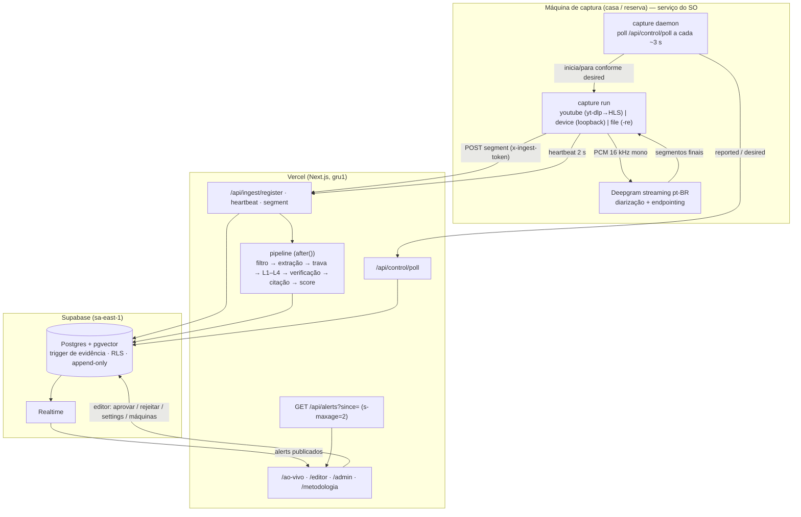

# Arquitetura

Checagem de fatos ao vivo do debate presidencial de 23/10/2026. O sistema escuta a transmissão, extrai afirmações checáveis, verifica contra uma base pré-carregada e a web, e publica **alertas curtos, sempre com fonte**.

Prioridades, nesta ordem: **precisão > latência > cobertura**. Na dúvida, silêncio.

## Visão geral



| Componente | Onde roda | Papel |
|---|---|---|
| `apps/capture` | Máquina do usuário (principal) + máquina reserva | Áudio → texto. Fino de propósito. |
| `apps/web` | Vercel, região `gru1` (São Paulo) | API de ingestão, pipeline, site público, /editor, /admin |
| `packages/pipeline` | Dentro das funções da Vercel | O “cérebro”: checa e decide |
| `packages/db` | Compartilhado | Tipos, contratos HTTP (zod), cliente Supabase, tiers de fontes |
| Supabase | `sa-east-1` | Banco, Auth dos editores, Realtime |
| `apps/kb-ingest` | Máquina da equipe (CLI) ou funções da Vercel (painel do /admin) | Carrega a base de conhecimento (L1–L3), antes **e durante** o debate: as páginas que a L4 traz entram na fila `kb_web_finds` e viram base pela etapa `web-finds` |
| `eval` | Máquina da equipe | Precisão e latência sobre conjunto rotulado |

### Por que a captura fica fora da Vercel

Uma função serverless não segura um stream de 2 horas, e IPs de datacenter são frequentemente bloqueados pelo YouTube. O capture agent roda numa máquina comum (a do usuário), faz só áudio → texto, e envia segmentos curtos por HTTP. Todo o resto (pipeline, base, UI) roda na Vercel.

## Captura e controle remoto

O usuário pode **não estar perto** da máquina de captura. Por isso a captura roda como **serviço do SO**:

- `pnpm --filter @actually/capture start -- install-service --name casa` instala o `capture daemon --name casa` para subir no boot, com reinício automático e sem deixar a máquina suspender enquanto captura.
- O daemon chama `POST /api/control/poll` a cada ~3 s com o `x-ingest-token`. A chamada faz upsert da máquina em `capture_machines` (pelo nome), grava o estado **reportado** (`reported`: estado, agente, se é o ativo, nível de áudio em dBFS, último segmento, reconexões, erro, últimas linhas de log) e devolve o estado **desejado** (`desired`) definido no /admin.
- `desired` = `{ state: running|stopped, debate_slug, source, url|device, role, start_at, stop_at }`. Com `start_at`, o daemon espera até o horário — comparando com o `server_time` devolvido pelo poll, não com o relógio local. Com `stop_at`, para sozinho (proteção contra esquecer ligado).
- Quando `desired.state = running`, o daemon executa internamente o mesmo `run` do terminal. Se o controle (poll) falhar, **a captura em andamento continua** — o daemon só muda de estado com uma instrução nova.
- No /admin → “Máquinas de captura” o editor vê cada máquina (online pelo `last_seen`, ativo, nível de áudio, último segmento, erros, log) e pode iniciar agora, agendar, parar, e trocar fonte/URL/papel. Mudanças em `desired` registram `desired_updated_at`/`desired_updated_by` por trigger.

Comando manual equivalente (terminal), útil em ensaio ou se o daemon falhar:

```bash
pnpm --filter @actually/capture start -- run --debate <slug> --name principal --role primary --source youtube --url <url>
pnpm --filter @actually/capture start -- run --debate <slug> --name reserva  --role standby --source device --device <spec>
```

### Redundância e failover

- Cada processo de captura se registra (`/api/ingest/register`) como agente do debate, com papel `primary` ou `standby`, e manda **heartbeat a cada 1 s** (sem esperar o anterior; um beat lento não atrasa os seguintes).
- A função `capture_heartbeat` (no banco, com lock por debate) mantém **no máximo um agente ativo** por debate (índice único parcial). Se o ativo fica sem heartbeat por `failover_after_s` (padrão 10 s), promove o agente vivo mais adequado (primary antes de standby).
- `/api/ingest/segment` só aceita segmentos do agente **ativo**; os do standby voltam `{status: "standby"}` e são descartados. Assim não há duplicação mesmo com as duas máquinas transcrevendo.
- Troca manual: /admin → “tornar ativo” (`capture_set_active`, só editor).
- Retry de segmento é idempotente: `unique (agent_id, seq)` → `{status: "duplicate"}`.

## Fluxo por segmento

```
fala termina ─► Deepgram finaliza ─► POST /api/ingest/segment ─► grava em segments ─► 202 accepted
                                                                     │ (after(): pipeline em segundo plano)
                                                                     ▼
 1 Filtro checável (Haiku) ── nada checável? ──► fim (silêncio)
 2 Extração atômica com contexto de 60 s (Haiku): afirmação autocontida, números, período, indicador, tópico
 3 Trava de repetição: hash igual OU similaridade ≥ 0,92 E mesmos números/períodos ──► reusa veredito, alerta “Repetido”
 4 Retrieval em paralelo: L1 checagens | L2 indicadores (SQL) | L3 documentos (híbrido vetor + texto, RRF)
      └─ base fraca ou nada conclusivo? ─► L4 web (Tavily restrito a domínios tier 1–2), em paralelo
         (desligável por debate: web_search = false no /admin ⇒ a L4 nem começa)
 5 Verificação (Sonnet, saída estruturada): veredito, correção de 1 linha, trecho citado, confiança
 6 Verificação programática da citação: o trecho precisa existir no texto da fonte (normalizado/fuzzy);
      L2: evidência gerada em código a partir do ponto da série, comparação numérica com tolerância
 7 Score final + thresholds + regras duras ─► alerta published | pending_review, ou só log
```

O segmento é aceito antes de o pipeline rodar (`after()` do Next), para não travar a fila do agente. Falha de uma afirmação não derruba as outras: registra e segue — **silêncio é o modo seguro**. Se a Anthropic, a Voyage ou a Tavily estiverem fora, o resultado é ausência de alertas, nunca um alerta improvisado.

Cada verificação grava `latency_ms` por etapa; o `/admin` e o `eval latency-report` mostram p50/p95.

### Decisão do alerta (score)

- `final_score` combina confiança do modelo, tier da fonte, concordância entre camadas e citação verificada. A concordância só vale 1 com ≥ 2 camadas **de veículos diferentes** (`sourceIdentity` em `packages/db/src/tiers.ts`): a checagem por fala na L1 e a página da mesma agência na L3 contam como uma fonte só.
- **Vermelho** (contradito pelas fontes): `final_score ≥ t_red` **e** evidência de fonte com tier ≤ `KIND_RULES[kind].red_max_tier` (hoje **3** em fato, estatística e acusação; **2** em opinião mensurável, que além disso nunca passa de amarelo) e citação verificada. Como o tier pesa no score (peso 0,6 no nível 3), uma camada só de nível 3 chega no máximo a 0,82 — abaixo do `t_red` padrão: nível 3 vira vermelho com duas camadas concordando, ou com `t_red` menor.
- **Amarelo** (impreciso): `final_score ≥ t_yellow` e citação verificada.
- Se a melhor evidência veio da web (L4), soma-se `web_penalty` ao threshold — exceto quando há citação verificada de checagem de agência (nível 1, tipo `checagem` em `SOURCE_TIERS`), vinda da web ou entrada fraca junto com ela.
- `confirmado` e `inconclusivo` nunca viram alerta; ficam só no log.
- Defaults: `t_red = 0,85`, `t_yellow = 0,75`, `web_penalty = 0,05`; calibrados com `eval` (ver `eval/README.md`).
- `web_search` (padrão ligado) desliga a L4 no debate: a base passa a ser a única fonte, a Tavily não é chamada e cada verificação grava `web_search_off` em `score_components`. Documento que a base aprendeu da web (`origin = 'web'`) continua pagando `web_penalty`.

## Camadas de conhecimento

| Camada | Tabela(s) | Conteúdo | Busca |
|---|---|---|---|
| **L1** — checagens | `kb_factchecks` | Checagens publicadas (agências, Google Fact Check Tools) | híbrida: HNSW (vetor) + GIN (texto), fundidas por RRF (`match_factchecks`) |
| **L2** — indicadores | `indicator_series`, `indicator_values` | Séries oficiais (BCB SGS, IBGE SIDRA, INPE…) com aliases | `find_indicator` (trigram sem acento) + SQL por período; comparação numérica em código |
| **L3** — documentos | `kb_documents`, `kb_chunks` | Debates, programas de governo, entrevistas, votações, discursos | híbrida (`match_chunks`), filtro opcional por pessoa |
| **L4** — web | — | Busca ao vivo (Tavily) restrita a domínios tier 1–2 | só se L1–L3 não forem conclusivos; paga `web_penalty` (menos checagem de agência); desligável por debate (`web_search`). Começa junto com L1–L3; camada da base que estoura o prazo enquanto a L4 roda ainda pode chegar até a L4 terminar |

Catálogo completo em [fontes.md](fontes.md). Tiers em `packages/db/src/tiers.ts` (`SOURCE_TIERS`).

## Garantias no banco

As regras que não podem falhar ficam no Postgres, não no prompt:

- **Correção sem fonte não existe.** Trigger `alerts_require_evidence`: nenhum alerta vai para `published` (no insert ou no update, inclusive por aprovação do editor) sem pelo menos uma `evidence` com URL `http(s)`, trecho não vazio e `quote_verified = true`. `evidence.url` e `evidence.quote` são `not null` com `check`.
- **Alertas só para correções**: `alerts.verdict` aceita apenas `contradito` e `impreciso`.
- **RLS**: o papel `anon` lê só `alerts` com `status = 'published'` e a verificação/evidência ligadas a eles, além de `debates`, `segments`, `speaker_map` e `source_tiers`. Pendentes e rejeitados só para editores (`is_editor()`). Escrita do pipeline e do kb-ingest só com service role. Tabelas da base (`kb_*`, `indicator_*`) têm RLS sem políticas: só o service role acessa.
- **Append-only / auditoria**: `segments`, `verifications`, `evidence` e `alert_events` não aceitam `update`/`delete`; `alerts` não aceita `delete` (só muda de status). Toda criação e mudança de status de alerta gera uma linha em `alert_events` com antes/depois e o autor.
- **Trava de repetição sem corrida**: índice único `(debate_id, claim_hash)` para afirmações originais.
- **Failover atômico**: `capture_heartbeat` com `pg_advisory_xact_lock` por debate; índice único parcial garante um único ativo.
- **Hardening** (migration 3): `search_path` fixo nas funções; `capture_heartbeat` executável só pelo service role (API); `capture_set_active` só para autenticados que sejam editores.

## Entrega

- **Realtime** (principal): o site assina inserts/updates de `alerts`; a RLS garante que o público só recebe os publicados. Ao receber o evento, busca o alerta com evidências.
- **Fallback com cache de CDN**: `GET /api/alerts?debate=<slug>&since=<iso>` responde com `Cache-Control: s-maxage=2`. Se o Realtime cair ou saturar, o cliente passa a fazer polling nesse endpoint automaticamente. Com o cache da CDN, o custo é O(1) por intervalo, não por usuário.
- Formato do alerta: selo (Contradito pelas fontes / Impreciso) + afirmação + 1 linha do dado correto + **fonte (nome + link + trecho)** + horário + “Verifique a fonte”. Repetições aparecem como “Repetido — já verificado às HH:MM”.
- `/ao-vivo/<debate>`: com player do YouTube ou modo “só informações” (preferência lembrada no navegador); aviso jurídico bloqueante na primeira entrada.

## Acesso

- `/editor` e `/admin` exigem login (Supabase Auth) de um usuário presente na tabela `editors`. Com `REQUIRE_MFA=1`, exigem também 2FA TOTP (nível `aal2`). Ver [setup.md](setup.md).
- Capture agent e daemon autenticam por `INGEST_TOKEN` (cabeçalho `x-ingest-token`, comparação em tempo constante).

## Decisões e porquês

| Decisão | Por quê |
|---|---|
| Supabase (Postgres + pgvector + Realtime + Auth) | Um serviço só para dados, busca vetorial, push e login; garantias em SQL (trigger, RLS). |
| Vercel `gru1` + Supabase `sa-east-1` | Mesma região (São Paulo): menos latência entre pipeline e banco. |
| Captura fora da Vercel, na máquina do usuário | Stream longo não cabe em serverless; IP residencial evita bloqueio do YouTube. |
| Daemon com controle remoto | O usuário pode não estar perto da máquina no dia; tudo se opera pelo /admin. |
| Haiku no filtro/extração, Sonnet só na verificação | Filtro roda em todo segmento (barato e rápido); verificação roda poucas vezes (precisa ser boa). |
| Regras duras no banco, não no prompt | Prompt pode falhar; trigger não. |
| Vermelho exige nível de fonte por tipo (`red_max_tier`) + citação verificada | Um vermelho errado é o pior erro possível. O limite é 3 em fato, estatística e acusação, e 2 em opinião mensurável; o peso do tier no score faz o nível 3 precisar de duas camadas concordando. |
| HITL de vermelhos como chave | A decisão de usar depende de precisão e latência medidas. Ver [human-in-the-loop.md](human-in-the-loop.md). |
| Sem nome do candidato por padrão | Diarização pode trocar falantes; atribuir errado é grave. Ver [atribuicao.md](atribuicao.md). |
| Trava de repetição com números iguais | Candidatos repetem frases; reusar o veredito economiza latência e custo e garante consistência. “Desemprego 6%” ≠ “desemprego 8%”. |
| Realtime + fallback CDN | Realtime tem limite de conexões; o feed cacheável aguenta pico sem custo por usuário. |
| Silêncio em falha | Melhor não dizer nada do que dizer algo sem fonte. |

## Documentos relacionados

- [requisitos.md](requisitos.md) — RF/RNF com critérios de aceite
- [human-in-the-loop.md](human-in-the-loop.md) · [atribuicao.md](atribuicao.md) · [metodologia.md](metodologia.md)
- [fontes.md](fontes.md) · [setup.md](setup.md) · [runbook-debate.md](runbook-debate.md)
- [`eval/README.md`](../eval/README.md)
